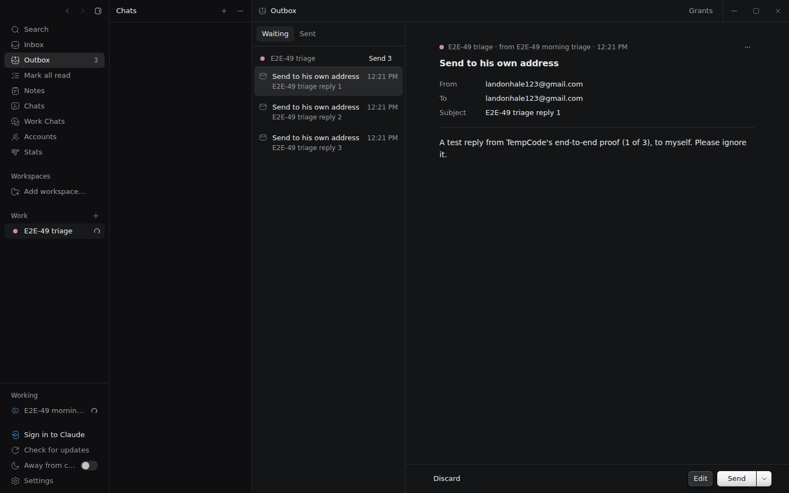
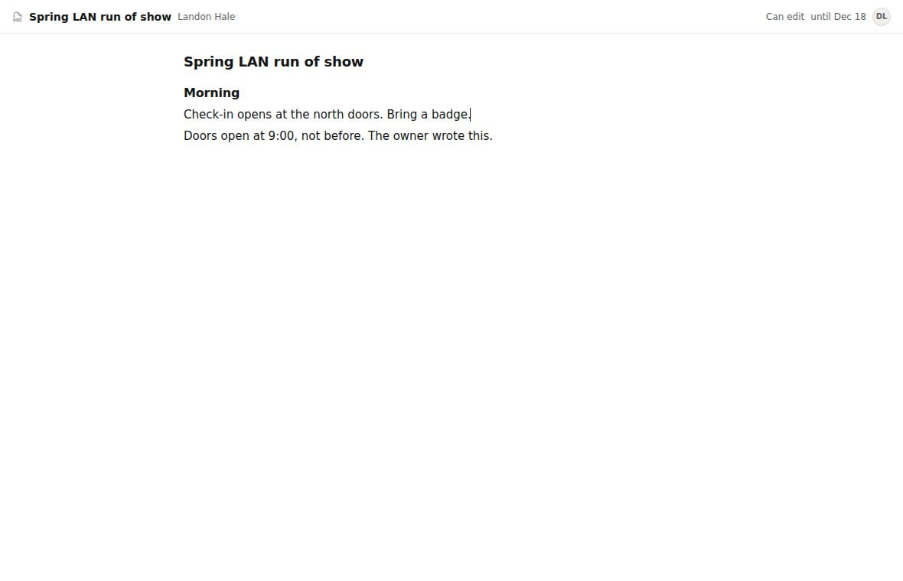
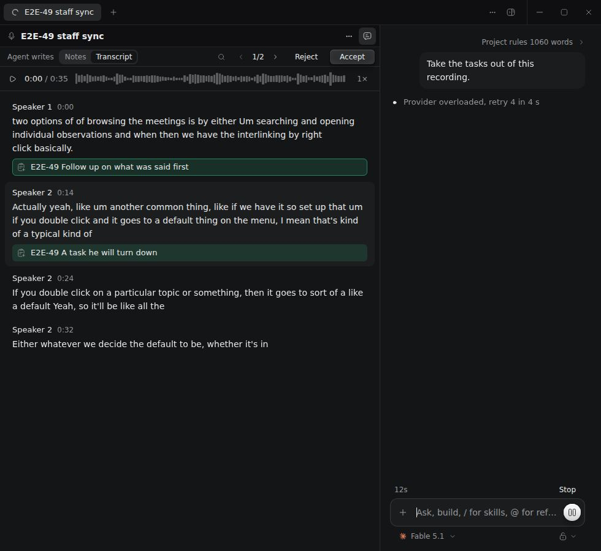
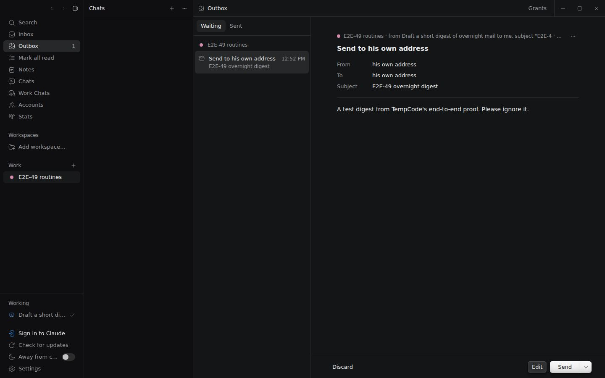
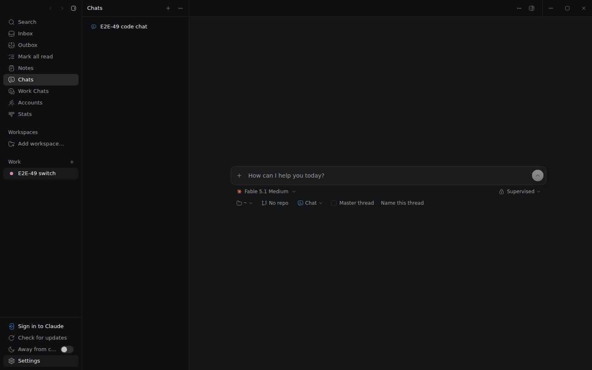
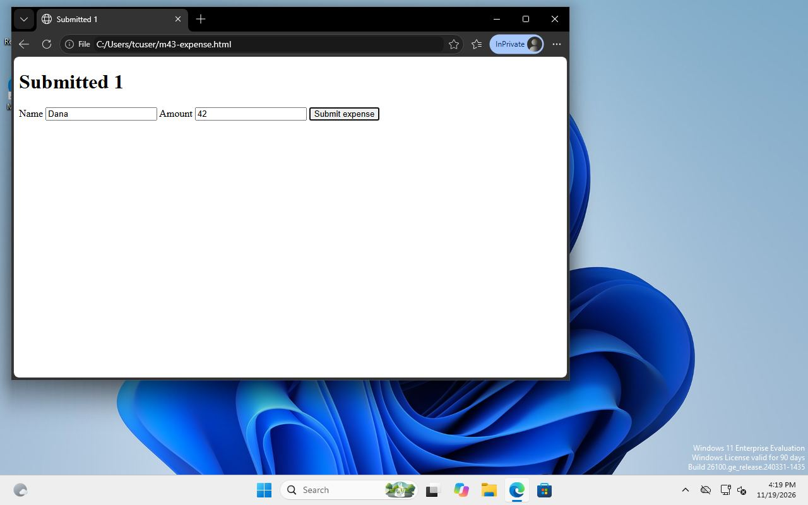
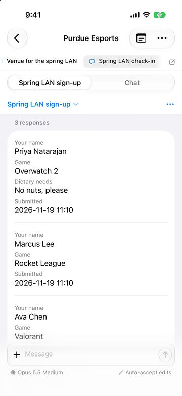
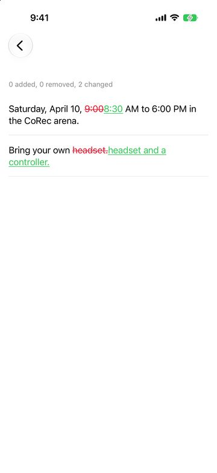

# Work: end-to-end proofs

Work proofs cover full jobs, file edits, and the rules that hold an action
for approval. The command table gives each run's setup, time, and account
use. The Milestone 49 results record what the original runs proved.

## Journeys

A journey walks Work as a person would. It ends by checking the file, a row
on its host, or what the window shows. Every walk starts fresh for its
journey and shape. It gets its own workspace, instances, dummy files, and
loopback provider addresses. Each instance has an isolated home, app data,
CLI config, temporary files, and empty VM path.

`win` is the window under xvfb. It holds the dummy Teams library L1 and
reaches the Work workspace on the headless `box` with a key made for the
walk. B2 and `--desk` start a third instance with library L2. It has its
own window under xvfb and links to `box` so the workspace can use its files.
Walks that need shared work tools use a read-only mount.

- **A** opens a file in the workspace's own folder on `box`.
- **B1** opens a file from L1 on `win`.
- **B2** is for L2 on `desk`.
- **V**, **S**, **K**, and **U** are for the Windows VM, sandbox LifeOS,
  a given computer's key, and a browser or guest page, in that order.
  The tier-1 shell and hold journeys also use K and U.
  The tier-2 LifeOS journeys use S. J55 also uses K to check a given computer’s key.

Each walk that uses LifeOS starts a loopback Convex sandbox. The runner
copies LifeOS from the local `origin/main` ref and work-kit from the commit
LifeOS pins. The source cache is under `.temp-code/journeys/.lifeos-cache/`.
Each sandbox has a fresh database, file store, admin key, and JWT keys.
The runner checks the deployment environment before minting a device token
or writing fixtures.

Box signs in to the sandbox. Capture also signs in on win. In shape S, the
window checks for Spring LAN mail in the Purdue workspace before the walk's
own steps. Walks that call a LifeOS draft tool start its local tool listener.
The sandbox runs no delivery worker. Queued mail and calendar writes wait
for a provider. The seed includes events that can move without a provider.

Build the worktree with `heavy bunx electron-vite build`, then run this
from that worktree:

```sh
HEAVY_MAX_MIN=40 /srv/agents/work/temp-code/.temp-code/bin/heavy bun run journeys --only J05,J10
```

Use `--list` to see the walks, `--shape A,B1` to pick file locations,
or `--tier 1` to pick a tier. `--only` runs journeys in the order given.
A failed step ends that walk. The runner revokes its keys, stops its
instances and sandbox, and checks for leftover processes and listeners
before starting the next walk. A walk that cannot start its sandbox
records `not run: no sandbox`. Any failure gives the command a non-zero
exit. `--keep` keeps the app and sandbox data for a closer look.

Find `results.json` under `.temp-code/journeys/<run>/` in the main checkout.
It includes cleanup proof for each walk and for the run. The walk folders
hold the host logs and screenshots. After a complete run with verified
teardown, the runner updates its walk rows in the Journeys table in
`.temp-code/plans/landed/POLISH-work.md`.
Use `--no-table` to keep the results in the run folder alone.

To add one, make a `scripts/journeys/JNN-<slug>.ts` file, export
`journey({ id, title, tier, shapes, steps })`, and add it to `JOURNEYS`
in `run.ts`. Give the last step a name that starts with `end:` and check
the thing the walk changed.

### Tier-1 Files journeys

| Journey | Shapes | What it checks at the end |
| --- | --- | --- |
| J01 | B1, B2 | The holder’s slide XML contains the edited title after closing the tab. |
| J02 | B1, B2 | Press × right after committing A1, and choose Keep trying if Work asks. The reopened grid and holder agree on A1, and each timed header reading agrees with the holder’s bytes. |
| J06 | A, B2 | A: the holder’s new slide contains the text typed before closing mid-word. B2: a far library offers no New deck, and its folder stays as it was. |
| J07 | B1, B2 | The holder’s text file contains the edit after closing the tab. |
| J08 | A, B1, B2 | The reopened PDF shows the highlight (a highlight has no note by design). |
| J13 | A, B2 | The renamed file alone holds the last edit. B2 renames on the third computer through the box, and the open tab's copy follows the new name. |
| J15 | A, B2 | A: Trash puts a file back. Deleting a file with unsent edits preserves the words or warns before discarding them. B2: Delete from the row sends the file to that computer's bin with Undo, and Delete from an open tab names its unsent words first. |
| J17 | A, B1, B2 | Each available tab or row action reaches its named result. |
| J18 | A, B1, B2 | Name and content hits open. The search accounts for any library content it skipped. |
| J19 | A, B2 | Starred and Recent both list the file after reload. |

Use the same list of IDs with `--shape A,B1`, then with `--shape B2 --desk`.
Each library journey gets a new folder on its holder. The window reaches
desk through box. J02 writes `save-lines.jsonl`, J17 writes `actions.jsonl`,
and J18 writes `search.jsonl` and `search-outcomes.jsonl` beside the pictures.
The Linux stand-ins can show a native Open in its app refusal. The journey
records the refusal as a failure when the window offers that action.

### Tier-1 editor journeys

| Journey | Shapes | What it checks at the end |
| --- | --- | --- |
| J03 | B1, B2 | The holder's workbook has a chart part and the PDF has pages and more than one stream. Both shapes start with a blank workbook on the holder. |
| J04 | B1 | The new Word file and reopened editor have both paragraphs. An untouched Word file leaves both folders as they were after close. |
| J09 | A, B1 | The picture has a natural size and the reopened video shows its comment at the stored frame. The workspace sound plays. The library sound opens in its own app on Mac or Windows, or gives the native-app refusal on the Linux stand-in. |
| J11 | A | Closing the side files returns the space to the chat and keeps the first file and draft visible. |
| J12 | B1 | A sent file chip opens the same tab as the Files row. The workspace and library together have one copy. |
| J14 | A, B1 | The original tab edits the file after two moves. An offered cross-computer copy holds those edits. |
| J16 | A | The desktop drop and File → Open File… both open in their kind and put their bytes in the workspace folder. |
| J22 | A | A Full editor change survives its window closing and appears in the TempCode grid and the workbook on box. |
| J23 | A, B1 | The copies take an edit and the four originals keep their SHA-256 hashes. |
| J25 | A | Compare marks the changed words. Restore changes the live document and History keeps the newer version. |
| J26 | A | The document, sheet and deck previews show the expected page counts, and the PDFs handed to Electron's viewer have Letter pages. |
| J71 | A, B1 | 42, 3.5, 007 and =A1*2 typed across A1 to D1, then the tab closed: the holder's workbook holds 42 and 3.5 as numbers, 007 as text and D1 as a formula (`cells.json`). |
| J72 | B1 | Save As… of a library Word file opens in its own folder; the holder gets one `TempCode proof agenda copy.docx`, the sheet closes with no "Not saved", and Save pressed again after any failure makes no "copy 2". |
| J73 | B1 | A library Word file opened, typed into, saved with Save to Teams as Word and Replace, and closed: the holder's file has the line, the workspace folder holds no new file, and the host's record names its document and its "before" copy under `<userData>/work-files/word` (`word-store.json`). |
| J74 | A, B1 | He types a slide title and presses Escape before the 2 s keep, then closes the tab. The holder's slide XML has the typed title. |

Use `--only J03,J04,J09,J11,J12,J14,J16,J22,J23,J25,J26,J71,J72,J73,J74 --shape A,B1` for the
first run and `--only J03 --shape B2 --desk` for the far library. Run the
commands through `heavy`. LibreOffice and ffmpeg prepare dummy fixtures
inside the run. J16 uses the dev picker hook for the native menu and a
`DataTransfer` carrying a `File` for the desktop drop. J26 uses a run-local
PDF viewer stand-in so the real Electron print call can finish without a
printer. The evidence folder holds the Word save readings, the Legacy
copy hashes, the chart PDF and the three print PDFs when those steps reach
their files.

### Tier-1 shell and hold journeys

| Journey | Shapes | What it checks |
| --- | --- | --- |
| J20 | S, U | A sandbox LifeOS document's Share makes a comment link on the host's configured origin. The guest selects words and comments. The owner sees it, revokes the link, and the open guest page stops answering. |
| J21 | B2 | The Word switch offers the dummy SharePoint address, the local tab names its editor, and the holder's bytes stay the same. The built webview needs a public Microsoft origin, so the journey stops at the offered address before navigation. |
| J24 | B2 | Desk's place shows an away notice and Retry. The open copy waits, then sends the edit to desk after it returns. |
| J27 | A, U | A phone-width /ui clicker can advance, go back, blank and end the separate slideshow. The host and the audience page agree. A read key can watch. |
| J28 | A | The made Word file contains the field value. The starter opens as a job copy, and Save as template puts a file on the shelf. |
| J29 | B1, B2 | The shared Word bytes change only after Make the change in Outbox. A stale second press does nothing and gives a reason. |
| J30 | A | A private document changes through the Work tool. The editor's Undo restores its words on disk. |
| J31 | A | A file made through the Work tool is on disk and under Made by threads. Its chip opens that same file. |
| J52 | A | Files, its selected file and the Ask draft return after a workspace switch, a reload and a relaunch. |
| J53 | A, K | Work writes only to hosts the key can manage. Workspace creation and Add folder persist or say who can act. |
| J54 | K | The pairing dialog gives a reachable link and matching QR or explains why there is none. Cancel revokes its pairing. |
| J56 | A, B1 | Text typed before and during a cut to box reaches the file after reconnect. |
| J75 | A, B1 | Two text edits typed with win's link cut, then win killed with no word (SIGKILL) and started again: the reopened file offers the draft, and Restore puts both edits on the holder. Again, with the file changed on its holder while win was gone: in A the offer says the file changed since and Keep Both puts the draft beside the newer file; in B1 the draft goes back into box's copy and the copy's own line offers Keep Both. The holder keeps the newer file and the draft beside it. |
| J57 | A, K | An owner's edit reaches the open tab in a second window. The given computer's key limits its controls. |
| J58 | A | New chats keep box's access, provider, model, effort and Work scope across start surfaces. The walks that need LifeOS are skipped. |

For both guest walks, use `--only J20 --shape S,U --no-table`.
For the rest of the first run, use
`--only J27,J28,J29,J30,J31,J52,J53,J54,J56,J57,J58,J75 --shape A,B1,K,U --no-table`.
Run `--only J21,J24,J29 --shape B2 --desk --no-table` for the far library.
Use `heavy` for both. With `--no-table`, the runner keeps its evidence in
the run folder and skips the shared Journeys table.

K uses a second window with the given computer's actual device key, bound
through the app's isolated device proof. The owner window stays connected.
U uses Playwright's Chromium with a new profile for each pairing or guest
visit. The runner waits for Chromium to exit before removing its profile.
A hop with no delay that presents box's own Host (`shapedRelay`; box refuses a page's socket with another Host) cuts just win's link to box in J56 and J75; J75 kills win at once (`halt(win, true)`). J24 stops and restarts
desk on the same data. The thread journeys call the Work bridge with the
run's own thread tokens. J29 pairs a dummy Word add-in on the isolated
Work service. It answers reads of the fixture and writes only the named
change. The SharePoint address names the file in the Office protocol.
J31 and J58 send only through the fake provider. J58 checks each session
row as soon as it exists. The runner revokes the browser
sessions, pairings and keys before stopping the instances.

### Tier-2 LifeOS journeys

| Journey | Shapes | What it checks |
| --- | --- | --- |
| J40 | S | The same task stays due today as the owner completes it and undoes completion. Today shows it while open. |
| J33 | S | The same reply goes from draft to queued, back to draft, and to queued again. The window gives the send's state. |
| J32 | S | A thread’s mail tool makes a draft. The edit reaches the LifeOS queue, and Outbox shows how long it has waited. |
| J34 | S | Scheduled and the thread foot show the owner's timed reply. Cancel keeps its time on the draft. Only a thread-origin reply also appears in Outbox, with Cancel send alone. |
| J35 | S, A | Mail opens the attachment read-only, saves the original bytes to the workspace, and keeps an editable document there. |
| J36 | S | A mail-side Work thread drafts through its own tool. The owner's press queues that same reply. |
| J37 | S | A task points to its source mail, and its own thread points back to that task. |
| J38 | S | An overdue mail wait opens a nudge thread. Its draft and the original wait both stay. |
| J39 | S | A Slack reply remains queued and the screen says it is on its way. The conversation's stored file opens beside it. |
| J42 | S | The meeting keeps its brief and notes. Only the ticked suggestion becomes a task. The follow-up mail waits for a press. |
| J44 | S | The mail sender opens the right People page and the new thread keeps the person's chip. |
| J50 | S, A | The digest gives a held item and a meeting deadline once. Open goes to the meeting the toast named. |
| J51 | S | Today opens the held item, meeting, due task, waiting mail, unanswered chat, owed row, and ready weekly review. Review settles the slipped task in LifeOS. |
| J41 | S | The New event toast follows the calendar operation. A local move changes the clash shown on Agenda. |
| J55 | S, K | Connections agrees with the hosts. LifeOS views show the sign-in state, and the given computer sees that its key cannot read them. |
| J61 | S | Start thread on a Spring LAN task makes a box row under that project's mirror. The column shows the project, and its page marks the task with the thread. |

### Tier-3 journeys

| Journey | Shape | What the walk checks |
| --- | --- | --- |
| J43 | A | A dummy recording reaches the transcript and the Notes tab, with a note tied to a turn. Export transcript’s file holds that turn. |
| J45 | A | A receipt waits for Review. Save puts its figures and receipt ref in one row of `Money/Ledger.tcsheet`. |
| J46 | A | Create prints an invoice PDF to the job's folder. Export writes the year's CSV, Excel file and PDF. |
| J47 | A | A weekday morning routine uses America/New_York. Run now creates a Work thread on box with the chosen Thread defaults. Pause turns the routine off. |
| J48 | A | Save as a play keeps a Work thread's instructions with a File input. Start uses a dummy LifeOS document. |
| J49 | A | Capture uses win's global shortcut on its private X display and files through sandbox LifeOS. `landed.json` records which host holds the file and which holds the thread. |
| J59 | A, U | Appearance sets Work to Light. Pictures and `surfaces.json` show the theme marker and computed background of each surface. The slideshow’s audience window stays dark on purpose; every other surface wears light. In U, Capture and the Full editor are “not walked”, with the reason. |
| J60 | A | A box thread opens a private loopback page in headed Chromium beside the chat. Take over and Hand back change the driver on box. A Linux window draws no picture, so its canvas says “Shown on box only”; on a Mac’s or a PC’s window he clicks the page through the picture. |

Run these IDs with `--only J43,J45,J46,J47,J48,J49,J59,J60 --no-table` in a built worktree.
J48, J49 and J59 start a local LifeOS sandbox. J59 uses a fresh guest browser profile.
Every Tier-3 step takes a picture. The run's `cleanup` names the ports it
checked and any listener or process left after it stopped.

## Running them

Run from the repo root. Times are estimates for one run, excluding the queue
and a prior build. For Linux, a private display means Xvfb and D-Bus. Run
Electron, Chromium and benchmarks through `heavy`. A nonzero exit means a
failed check or a failed setup. The table names proofs that use real services
or a Windows VM. Use the script header for its flags and setup steps.

| Proof | Command | Time | Real account or LifeOS | Needs |
| --- | --- | --- | --- | --- |
| `scripts/e2e-files.ts` | `bun run script:e2e-files` | <1 min | No | Bun, SQLite |
| `scripts/e2e-review.ts` | `bun run script:e2e-review` | <1 min | No | Bun, SQLite, LifeOS stand-in |
| `scripts/proof-digest.ts` | `bun run script:proof-digest` | <1 min | No | Bun, SQLite |
| `scripts/proof-full-access.ts` | `bun run script:proof-full-access` | <1 min | No | Bun, SQLite |
| `scripts/proof-templates.ts` | `bun run script:proof-templates` | <1 min, or 1–3 min with tools | No | Bun, SQLite. Optional: `TEMP_CODE_WORK_TOOLS_DATA` with Python and LibreOffice. |
| `scripts/e2e-money.ts` | `bun run script:e2e-money` | 1–3 min | No | Bun, SQLite and Work receipt tools |
| `scripts/e2e-work-files.ts` | `bun run script:e2e-work-files` | 2–6 min | No | Built app and private display, two fixtures. Optional: Work preview tools. |
| `scripts/e2e-work-files-thread.ts` | `bun run script:e2e-work-files-thread` | 1–3 min | No | Built app, private display, dummy Teams library |
| `scripts/e2e-files-open-remote.ts` | `bun run script:e2e-files-open-remote` | 2–5 min | No | Built app and private display, two scratch hosts |
| `scripts/e2e-files-copy-edit.ts` | `bun run script:e2e-files-copy-edit` | 4–12 min | No | Built app, private display, LibreOffice, unzip. Optional: `--nine`. |
| `scripts/e2e-save-as-remote.ts` | `bun run script:e2e-save-as-remote` | 2–5 min | No | Built app and private display, two scratch hosts |
| `scripts/e2e-canvas-close.ts` | `bun run script:e2e-canvas-close` | 2–5 min | No | Built app, private display and unzip |
| `scripts/e2e-sheet-files-save.ts` | `bun run script:e2e-sheet-files-save` | 2–5 min | No | Built app, private display, scratch workbooks |
| `scripts/e2e-export-preview-remote.ts` | `bun run script:e2e-export-preview-remote` | 2–5 min | No | Built app, private display, Work format tools |
| `scripts/e2e-full-editor-remote.ts` | `bun run script:e2e-full-editor-remote` | 2–6 min | No | Built app, private display, ONLYOFFICE and Playwright Chromium |
| `scripts/e2e-remote-media.ts` | `bun run script:e2e-remote-media` | 1–3 min | No | Built app and two scratch hosts |
| `scripts/e2e-work-return.ts` | `bun run script:e2e-work-return` | 1–3 min | No | Built app and private display |
| `scripts/e2e-work-switchoff.ts` | `bun run script:e2e-work-switchoff` | 1–3 min | No | Built app, private display and SQLite CLI |
| `scripts/e2e-work-search.ts` | `bun run script:e2e-work-search` | 1–3 min | No | Built app, private display, LifeOS stand-in |
| `scripts/e2e-mail-chat.ts` | `bun run script:e2e-mail-chat` | 1–3 min | No | Built app, private display and mail fixtures |
| `scripts/e2e-templates.ts` | `bun run script:e2e-templates` | 2–5 min | No | Built app, private display and template fixtures |
| `scripts/e2e-work-digest.ts` | `bun run script:e2e-work-digest` | 2–4 min | No | Built app, private display and fake add-on |
| `scripts/e2e-work-document.ts` | `bun run script:e2e-work-document` | 1–4 min, plus 1–4 min for guest | No | Built app, private display, Python and LibreOffice. Guest needs hosted build and Chromium. Set `E2E_GUEST=0` to run the document leg alone. |
| `scripts/proof-doc-window.ts` | `bun run script:proof-doc-window` | 2–5 min | No | Built app, private display and Work format tools |
| `scripts/proof-doc-gate.ts` | `bun run script:proof-doc-gate` | 4–10 min | No | Two built trees, private display and Work format tools |
| `scripts/proof-doc-guest-phone.ts` | `bun run script:proof-doc-guest-phone` | 2–6 min | No | Hosted build and Playwright Chromium. Desktop leg needs a built app and format tools. |
| `scripts/e2e-phone-hosted.ts` | `bun run script:e2e-phone-hosted` | 3–8 min | No | Playwright WebKit. Builds hosted pages and starts a scratch host. |
| `scripts/proof-office-live-fence.ts` | `bun run script:proof-office-live-fence` | 1–3 min | No | Bun, Electron, private display and fake origins |
| `scripts/e2e-box-video.ts` | `bun run script:e2e-box-video` | 2–6 min | No | Chromium, screen relay and private display |
| `scripts/e2e-work-files-lifeos.ts` | `E2E_REAL_LIFEOS=1 bun run script:e2e-work-files-lifeos` | 1–4 min | Yes, LifeOS documents | Built app and private display. Makes, renames, trashes and restores one document. |
| `scripts/e2e-work-triage.ts` | `E2E_REAL_LIFEOS=1 bun run script:e2e-work-triage` | 2–5 min | Yes, LifeOS and mail | Built app and private display. `E2E_SEND=1` sends one mail to the owner. |
| `scripts/e2e-work-report.ts` | `E2E_REAL_LIFEOS=1 bun run script:e2e-work-report` | 2–5 min | Yes, LifeOS and mail drafts | Built app, private display and Python with openpyxl |
| `scripts/e2e-work-meeting.ts` | `E2E_REAL_LIFEOS=1 bun run script:e2e-work-meeting` | 2–10 min | Yes, LifeOS tasks | Built app, private display, speech tools and fixture recording |
| `scripts/e2e-work-routine.ts` | `E2E_REAL_LIFEOS=1 bun run script:e2e-work-routine` | 3–7 min | Yes, LifeOS and mail drafts | Built app and private display. Waits for a real schedule. |
| `scripts/e2e-prep.ts` | `E2E_REAL_LIFEOS=1 bun run script:e2e-prep` | 3–7 min | Yes, LifeOS calendar, tasks and drafts | Built app and private display |
| `scripts/e2e-work-sweep.ts` | `E2E_REAL_LIFEOS=1 bun run script:e2e-work-sweep` | 1–3 min | Yes, LifeOS records, keys and sessions | Explicit maintenance command for earlier proof runs. Run alone. |
| `scripts/e2e-office-live.ts` | `bun run script:e2e-office-live` | 3–10 min | Yes, signed-in Microsoft profile and OneDrive | Chromium, Electron, private display and dummy document in OneDrive |
| `scripts/proof-mac-bin.ts` | `bun run script:proof-mac-bin` | 1–3 min | Cloud leg uses the Mac’s OneDrive | macOS, Finder and scratch files |
| `scripts/probe-mac-onedrive.ts` | `bun run script:probe-mac-onedrive` | <1 min | Reads the Mac’s OneDrive mount settings | macOS |
| `scripts/e2e-box-vm-edit.ts` | `bun run script:e2e-box-vm-edit` | 8–25 min | Yes, deployed box and standing VM OneDrive | Built app via `--app <dir> --out <dir>`, scratch VM files |
| `scripts/proof-files-standing.ts` | `bun run script:proof-files-standing` | 2–5 min | Yes, standing VM and its OneDrive | Authorized SSH and standing helper |
| `scripts/probe-vm-copy.ts` | `bun run script:probe-vm-copy` | 1–3 min | Standing VM and its mounted files | Authorized SSH, installed helper, forwarded socket and token |
| `scripts/probe-vm-live.ts` | `bun run script:probe-vm-live` | 1–3 min | Standing VM and its Office setup | Authorized SSH and installed helper |
| `scripts/proof-files-vm.ts` | `bun run script:proof-files-vm` | 3–10 min | No account. Uses the Windows rig. | Windows rig, built helper and dummy mount |
| `scripts/e2e-winvm-keeper.ts` | `bun run script:e2e-winvm-keeper` | 10–30 min | Standing Windows VM disk | Standing VM lock, base image and built helper |
| `scripts/e2e-winvm-points.ts` | `bun run script:e2e-winvm-points` | 5–15 min | Standing Windows VM disk | Standing VM lock and prepared disk |
| `scripts/e2e-winvm-stop.ts` | `bun run script:e2e-winvm-stop` | 5–15 min | No account. Uses the Windows rig. | Rig lock, base image and built helper |
| `scripts/e2e-winvm-picture.ts` | `bun run script:e2e-winvm-picture` | 10–30 min | Standing Windows VM disk | Standing VM lock, screen relay and base image |
| `scripts/e2e-winvm-work.ts` | `bun run script:e2e-winvm-work` | 10–30 min | Yes, real Claude login and standing Windows VM | Standing VM lock, built app and helper |
| `scripts/e2e-computer.ts` | `bun run script:e2e-computer` | 2–8 min | Uses a real model login and the Mac’s desktop | Mac idle check, permissions and scratch form |
| `scripts/e2e-session-move.ts` | `bun run script:e2e-session-move` | 1–4 min | No | Built app and two scratch hosts |
| `scripts/proof-box-load.ts` | `bun run script:proof-box-load` | 1–3 min | Reads admission from the live box. Adds load. | Private host, box load below 12 and heavy queue |
| `scripts/bench-files.ts` | `bun run script:bench-files` | 1–4 min | No | Scratch file fixtures and heavy queue |
| `scripts/bench-review.ts` | `bun run script:bench-review` | 1–4 min | No | Scratch database and heavy queue |
| `scripts/bench-sheet-save.ts` | `bun run script:bench-sheet-save` | 2–10 min | No | Scratch workbooks and heavy queue |
| `scripts/bench-work-search.ts` | `bun run script:bench-work-search` | 1–4 min | No | Scratch index and heavy queue |

The shared runner writes its pictures and a `run-*.txt` file under
`.temp-code/plans/landed/M49/<job>/` unless the script supplies another
default or takes `--out <dir>`. The Windows and live account rows require
their own setup. For a local routine check, run
`NODE_ENV=test bunx vitest run src/main/server/work/routines/engine.test.ts`.

What they share is `scripts/e2e-work-lib.ts` (`Run`):

- One windowed instance under xvfb, in a folder of its own under /tmp,
  with its own HOME, userData, Work root, debug port and Work service port. A
  child exit during a proof fails the run. Requests and cleanup have
  deadlines. Cleanup ends by stopping that run’s process group.
- It names `WINVM_DIR`, a folder of its own that holds no machine. Left unset, an isolated
  instance on the box reads the standing Windows VM under `/srv/agents/win-vm`, and its
  keeper's idle tick can hibernate that machine under his Work threads after 30 minutes.
  Every script that hands an instance `TEMP_CODE_USER_DATA` does the same
  (`scripts/noRealVm.test.ts`; its allow-list names the four that may not, with the reason).
  It uses the box's installed conversion and meeting tools by linking each
  tool's folder into the run's own `work-tools/`; the run keeps its own
  `jobs/`, `run/` and `downloads/`, though a tool may still write its own
  cache in its folder (Python's `__pycache__`).
- LifeOS: the run mints a device session (`auth:mint`, named
  `E2E-49 <run id> <job> <time>`, with the token kept out of logs) and its sign-out revokes it; the
  run checks the sign-out. Deleting a Work workspace revokes its key; at
  the end the run revokes every key its instance minted that is still live,
  the Work Chats key (which reads every sector) among them, by the names in
  its own database.
- The agent's side is called as a thread's bridge calls it: `app.workCall`
  and `app.addonCall` with that thread's own tokens, from seeds the run
  sets (`TEMP_CODE_APP_TOKEN_SEED`, `TEMP_CODE_WORK_TOKEN_SEED`). No model
  turn runs: the instance's provider is a dead address. The owner's side is
  the wire (`work.outbox.send`, `work.meetings.decide`, …) or a press in
  the window.
- The LifeOS runs opt in with `E2E_REAL_LIFEOS=1`. They give new rows
  an `E2E-49 <run id>` prefix. At the end, each run drops its tasks and
  discards its drafts by ID. The final check looks for rows with that
  run’s prefix and fails if it has to clean any up. The separate sweep
  checks the shared `E2E-49` prefix and can revoke keys or sessions from
  other runs. Run it when all other LifeOS proofs have stopped.
- Mail goes only to his own address. `E2E_SEND=1` lets the triage job send
  one mail to himself; every other run discards its drafts.
- A picture that could show his real lists (the rail, a workspace's
  column) is cut to the canvas and the thread (`shot(name, { clipLeft:
  460 })`). His address never reaches a check line or a picture: the run
  swaps it for "his own address" before each picture, and writes no picture
  that still shows it.

## Results

On the box (Linux, xvfb), 2026-11-19, on the branch's build over master with milestone 47 (`3aa164060`); every job ran twice in a row there, then once more with each change to its script.

| Job | What it proves | Runs |
|---|---|---|
| triage | morning triage to held drafts to the owner's batch | 2 of 2 (22 checks each) |
| report | a weekly report from a real .xlsx to a held mail | 2 of 2 (19) |
| document | a .docx through suggestions and a guest's edit to .docx, .odt, .md and PDF | 2 of 2 (17), and 2 of 2 on the Mac (17, guest leg left out) |
| meeting | a recording to accepted tasks in LifeOS | 2 of 2 (15) |
| routine | a routine that fires under Away and leaves a held item | 2 of 2 (17) |
| switchoff | Work off is the app before Work | 2 of 2 (17) |
| sweep | nothing a proof made is left in LifeOS | nothing live left; 20 proof tasks in LifeOS, all dropped |
| Windows hold | a Work thread's flagged submit on a Windows PC waits for his press | 2 of 2 in the rig |
| Mac | the document job under the Mac's Electron | 2 of 2 |
| Phone | the whole work set in the iOS simulator (45 shots), ios:test, ios:test:client | 2 of 2 |

### Morning triage to held drafts to a batch

A Work thread of his own mailbox's sector (Life) reads its key's guide
(Life only, draft-only), the inbox, files a task and drafts three replies
to his own address. The host stamps the thread's origin on each draft; all
three wait in the Outbox, grouped under the workspace with its "Send 3";
the thread's own `send_mail` is refused ("This key drafts and never
sends"). The owner sends the first through `work.outbox.send` with its
`rev` and discards the others: LifeOS records the sent one as `cause:
press`, to his address only, and every item is decided by the owner. The
first run sent that one mail; the second discarded all three.



### A weekly report from a sheet to a held mail

A real .xlsx (written by openpyxl, with a `=SUM` formula) opens in the
thread's canvas in the real Univer grid. `sheet_read` answers the week's
figures; the owner sets the sheet to suggest and the agent's revenue total
waits as a suggestion, the only one; the owner accepts it and the .xlsx on
disk holds `=SUM(C2:C6)` (read back by openpyxl). The agent drafts the
report from the rows it read; it waits in the Outbox with exactly those
figures, and the owner discards it.


### A document from a .docx

A Word file with a heading, paragraphs, a table and a reviewer's comment
(python-docx, author "Dana Lee") imports into a Work Chat's canvas as a
.tcdoc; the import answers `outsiders: true`. The agent reads the heading,
words, table and the comment. The owner sets it to suggest; the agent's
rewrite waits as one branch, tinted in the text, the text unchanged; Accept
all takes it. The document exports as .docx (python-docx reads back the
accepted words, the table and the comment), .odt and .md, and as a PDF
from Electron's own print window (`work.formats.print`, read back by
pdfium) — the print window's first run anywhere. The job hands the print
window the document's markdown as plain lines, not the editor's own page,
so the PDF shows `#` and table pipes: it proves the window, not the layout.

For the guest's edit the job runs milestone 31's live proof against this tree's built
hosted page: the real Work service and the guest page in headless
Chromium; a guest types into the owner's document and the owner's words
reach the guest; a view link writes nothing; a comment link marks words; a
revoked link ends the page. Why not live LifeOS: guest links share LifeOS
documents only, and a LifeOS document is served by the box's own Work
service, which runs only in the installed app on a Work build (below).




### A meeting file to accepted tasks

A 35-second recording of two people (the AMI corpus fixture) opens as a
meeting and is transcribed on the box: 4 turns, two speakers. The agent's
notes give two tasks resting on turns; both wait. The owner accepts one,
which the host files in his real LifeOS, in Life, with the description
"From “E2E-49 staff sync” at 0:00."; the rejected one is nowhere in LifeOS. The
filed task is dropped at the end with a reason.



### A routine that fires under Away

The owner turns Away on and saves a routine with a weekly rule for today,
two minutes ahead, in America/Chicago, ending after one run: the night's
firing brought forward. The host's engine fires it on its own clock and
starts a Work thread stamped with the run. That thread drafts the digest
through its own LifeOS key; the draft waits in the Outbox as the run's;
twenty seconds on, Away has released nothing; when the turn ends the run
says it holds one; the routine has ended. He turns Away off, sees the
digest waiting, and discards it.



### Work off is the app before Work

An instance that has never had Work on: the rail (Search, Inbox, Mark all
read, Notes, Chats, Accounts, Stats, workspaces), Settings' pages (Work is
listed, as the one switch), no Work service listening, a Work method
answering "Work is off on this host", a code thread given no Work tools.
Work is turned on (the service listens, the Outbox and Work Chats join the
rail, a Work workspace and a Work Chat are made) and off again: the rail
and Settings are as they were, the service has stopped, the method and the
code thread's tools answer as before (none, while on as well, when a Work
Chat gets its tools), and the database has gained no table (Work's tables
exist from the first boot). The Work workspace
is kept for when Work comes back.

The registry's own start paths are held by kept tests:
`work/switchOff.test.ts` (every way a code thread starts — a loose chat, a workspace chat, a project's
build with its rules, a child, one that opts out of the rules, Codex,
`app_start_thread`, `spawn_agent` — makes the same row and sends the same
first message with Work unset, off and on; it mounts no Work part, so it
holds what the registry itself does with the switch) and
`work/claude-driver.test.ts` (a code thread's Claude tool surface with no
Work, Work mounted and off, and Work on with a module's tools).




### Windows

`TC_WIN_RIG=1 NODE_ENV=test bunx vitest run src/main/server/computer/winRig.hold.test.ts`,
twice, on a fresh overlay of the rig: a Work thread's flagged click on
Edge's "Submit expense" became a live computer act in the real Outbox; under
Away the page stayed unsubmitted; his press submitted it once and a second
press posted nothing. The rig was stopped after.



The other Windows jobs do not apply: the rig has no Office, by the owner's
choice, so a workbook in real Excel on Windows is his PC's (below).

### The Mac

An Opus child on the Mac ran the document job twice from a scratch clone
(`/private/tmp`, its own userData and ports; the installed app untouched),
with `E2E_GUEST=0` and a scratch Python: 17 checks, all passed, both runs.
That is the .docx import with LibreOffice, the Work service's live editing
(Hocuspocus) under the Mac's Electron, suggestions and Accept all, the
exports, and the print window's PDF on macOS — the first time the service
and the print window ran on a Mac. The Mac had been idle 43 minutes and was
not locked. Excel 16.102.1 and Outlook 16.115 are installed; Word and
PowerPoint are not. Nothing was opened in Office (below).

### The phone

An Opus child on the Mac, on the branch over master with milestone 47:
`bun run ios:test` (51 tests) and `ios:test:client` (1,456 tests) passed;
the whole work set (`TC_PROOF_SET=work`: milestone 46's w01–w20 and 47's
w21–w45), simulator erased before each, passed twice (824 s and 712 s, all
45 shots). The host read back the same both times: the held mail sent from
the phone, what went was the phone's edit, a grant made from the post's
Send menu and the post going after it, Away on and off, both video comments
on the host at their frames (28 and 90).

It found a fault in the set: in a full run milestone 47's shots were taken
dark under "-light" names (milestone 46's part ends dark). It then made
three of milestone 47's four unproven lines run, in scripts only: the test
server can run the Work service in its own process
(`TC_TEST_WORK_SERVICE=1`), so the set now seeds a deck with two waiting
edits (LibreOffice 26.8.3 installed on the Mac with `brew install --cask
libreoffice`, python-pptx in a scratch venv named by `TC_PROOF_PPTX_VENV`),
a published form with three answers, and a history compare against a
second version. That run (milestone 47's part, light again) passed once.





## Faults the proofs found, and their fixes

- **Routines (milestone 32).** A run counted LifeOS's drafts by reading its
  threads' transcripts for a `draft_mail` call, so a draft made by any path
  the transcript does not name (a bridge call, as here) left the run
  "quiet: nothing held" while the Outbox showed it as the run's. A run now
  counts LifeOS's drafts from the Outbox's own list by the run their origin
  names, whenever the Outbox is watching LifeOS (a draft already sent or
  discarded no longer counts); the transcripts are read only otherwise.
  `routines/engine.ts` `heldBy`, two tests in `engine.test.ts`.
- **The Work service (milestone 18).** A token or an internal call made
  while the service was still starting was refused as "not running
  (starting)", so an agent's first document call after Work came on failed.
  Both now wait up to 20 s for a starting service. `service/ctx.ts`
  `runningSoon`, one test in `service/ctx.test.ts`.

Also from the phone leg, in the work set's scripts (milestones 46 and 47):
milestone 47's shots were dark in a full run; the slides seed passed
silently with LibreOffice present and never checked python-pptx. Both fixed
(above).

Seen and left as they are, for the pillar's owner to judge:

- A routine run's thread is titled by its prompt's first words ("Draft a
  short digest of…"), not the routine's name, and the Outbox's line names
  it so.
- The phone's history compare (w40) has no title saying which version it
  compares with the live document.
- With its provider at a dead address, a thread says "Provider overloaded,
  retry n in s" rather than that the provider cannot be reached.

## Still unproven

Each line: what, why it was not proven here, and what proves it. "Owner"
marks a step only he can take; the rest a later thread can run.

### Needs his accounts, his machines or his press

- **Real Office on the Mac** (milestones 28, 33, 21): Excel written
  through, its changes seen in the grid; Word and PowerPoint opening what
  we export; formatted Outlook mail. Why: Office scripting asks his one
  click per app on macOS's Automation prompt, needs the Apple Events
  entitlement in an installed build (F3; release 1.0.348 carries it), and
  no agent may answer that prompt for him. Word and PowerPoint are not
  installed on the Mac (Excel 16.102.1 and Outlook 16.115 are). Steps (owner, on the Mac, after
  installing a release with F3): from a Work thread whose workspace may use
  the Mac, with scratch files under /private/tmp only —
  1. Open Excel; make `/private/tmp/m28/xl-test.xlsx` with Sheet1 A1:C3
     values and C4 `=SUM(C1:C3)`. Ask the thread to call `office_files`;
     click Allow once on "TempCode wants to control Microsoft Excel".
  2. `office_range_read 'Sheet1'!A1:C4`, then `office_range_write
     'Sheet1'!A1` with the read hash: written. Type in A1 in Excel, write
     again with the old hash: `conflict`, nothing written.
     `office_range_undo` puts it back.
  3. Open the workbook in the sheet canvas; type in Excel and see the grid
     reload within 15 s; edit a cell in the grid and see it in Excel.
  4. Open Outlook, Allow once. `office_mail_send` to his own address from a
     non-Purdue account with bold, a link, a list and a 3×3 table: it is
     held; edit it in the Outbox, press Send, check the received copy.
  5. An invitation to himself from another account: `office_calendar_answer`
     accept is held; press; Outlook shows it accepted.
- **Every exported file in real Excel, Word and PowerPoint** (milestones
  21, 27, 33). Why: as above, and Word and PowerPoint are not on the Mac.
  Steps (owner, after installing Word and PowerPoint): open each file the proofs
  wrote — `.temp-code/plans/landed/M49/document/exports/` (.docx, .odt,
  .pdf), a sheet exported from the canvas (⋯ → Export → .xlsx), a deck from
  the slides canvas (.pptx) — in Word, Excel and PowerPoint; each opens with
  no repair prompt, the accepted words, the table and the reviewer's
  comment in the .docx, the formula's value in the .xlsx.
- **Office on Windows** (milestone 44). Why: the rig has no Office, by his
  choice. Steps: on a Windows PC with Office and TempCode installed, the
  checklist in landed/M44.md (COM reads and writes in Excel, Word,
  PowerPoint, classic Outlook; `Respond` on an invitation; a co-author's
  change; AppLocker refusing the helper in %TEMP%).
- **The Office add-in and Excel for the web** (milestone 29). Why: needs
  the tunnel rule (below) and his Microsoft sign-in. Steps (owner): the
  live test in landed/M29.md — sideload `addins/office/manifest.xml` in
  Excel for the web on a scratch OneDrive workbook, pair with the code from
  Settings → Work, `office_range_read`/`write` from a box Work thread, time
  a change by range, then Excel on the Mac through `wef/`.
- **Outlook on the web from the box** (milestone 38). Why: no agent may
  sign in as him. Steps (owner): landed/M38.md section 7 — export his
  Outlook cookies with `exportLogins.ts` (or sign in through the box
  browser over `chrome://inspect`), then `office_mail_list` on Sent, one
  formatted held send to himself, one calendar accept.
- **Google files** (milestone 30) and **Google calendar writes**
  (milestone 24). Why: needs his consent on his Google accounts, and two
  test Google accounts made with his phone. Steps (owner): landed/M30.md
  section 4 (consent on one personal account, the token route narrowing to
  `drive.file`, the client id, the Picker, a Doc and a Sheet round trip,
  then his Workspace account); landed/M24.md section 12 (make two test
  accounts; a thread finishes the live proof).
- **Frame.io** (milestone 48). Why: his Adobe sign-in, and the Settings
  rows are not mounted yet. Steps (owner): work-frameio.md, "The live
  test".
- **The tunnel's rule for the Work service** (milestones 18, 29, 31, 36).
  Guests, forms answered from outside, the phone's hosted editor and the
  Office add-in all go through `tempcode.landonhale.com/(g|w|f)/`, which is
  not applied. Steps (owner, on the Mac in the temp-code checkout with
  master pulled): `scripts/box/apply.sh --from 60 --through 60`; then on
  the box `cloudflared --config /etc/cloudflared/config.yml tunnel ingress
  rule https://tempcode.landonhale.com/w/doc/x` names
  `http://127.0.0.1:7695`.
- **LifeOS documents and sheets, live** (milestones 17, 19, 20, 27, 31).
  No LifeOS document or sheet exists yet: LifeOS's worker reaches the box's
  Work service at `/srv/agents/temp-code-data/work-service.sock`, which only
  the installed app on a Work build serves. Steps (owner): `box-update`,
  turn Work on for the box, turn LifeOS's `blockDocs` on; then in a Life
  Work thread `sheet_create` (a LifeOS sheet), Share → a guest link to
  himself opened in a private window, an edit there seen in TempCode.
- **Real model turns in Work threads** (milestones 6, 7, 14, 20, 23, 32,
  36, 39). No model has yet called a Work tool or a LifeOS tool in a real
  turn: every proof drove the thread's tools with its own tokens. Why: the
  Claude accounts are at their weekly cap, and copying the box's sign-in
  into a dev instance could rotate its refresh token. Steps (a later
  thread, when usage allows, or the owner once Work is on): in a Life Work
  thread, "Draft a mail to me with the subject Test and the body Hello":
  the draft is held in the Outbox with the thread's origin; a routine whose
  prompt drafts the same settles "Held 1".
- **Computer use on the Mac, live** (milestones 37, 10): portals, Teams
  posts and a held act on the Mac's own screen. Why: not run here, to keep
  to one Mac child at a time and the little usage left; the Mac was idle
  and unlocked during the Mac leg, so a child can run it.
  Steps: a Mac child after five idle minutes (the memory's idle gate) runs
  `bun scripts/e2e-computer.ts`; or the owner
  asks a Work thread on the Mac to fill a test form and presses its Send.
- **LifeOS desktop's approve-a-sign-in sheet** (milestones 2, 7, 8). Why:
  it ships with the next LifeOS desktop release; every proof signed in by a
  minted session. Steps (owner): after that release, Settings → Work → Sign
  in on a dev instance, approve the code in LifeOS desktop.
- **The hosted editor on the phone** (milestone 47): a LifeOS document
  edited in the web view and a suggestion accepted there. Why: the hosted
  editor serves LifeOS documents only, the simulator's test server has no
  LifeOS, and pressing Accept inside the web view needs a launch hook in the
  app. Steps: with the box's Work service live (above), open a LifeOS
  document from a phone thread's item row and accept a suggestion in its
  review; or a later milestone adds the hook and a scratch Convex behind
  the test server.
- **Accept pressed on a deck from the phone** (milestone 47): the deck and
  its review row are shown; the app has no launch hook to press Accept.
- **The phone on a real device** (milestones 45, 46, 47): lock-screen
  notices through APNs, the Duo's open postures, an iPad's windows. Steps
  (owner): install the Ad Hoc build, sign in, turn Away on, have a Work
  thread hold a mail, tap the notice.
- **The Purdue PC as a host** (milestones 41, 44). His choice; steps in
  the plan's open question 5.

### A later thread can prove

- **Two hosts live** (milestones 6, 8, 9, 14): a Work thread moved between
  two running instances, the switch written to both, Outbox items merged
  from two hosts. Proven on two databases and with fake hosts. Steps:
  `bun scripts/e2e-session-move.ts` with a Work thread added, or two
  `Run`s paired as `lifeos/proof/harness.ts` `pair` does.
- **The hourly LifeOS JWT refresh on a live connection** (milestone 7):
  a run held open past an hour.
- **The sheet worker as a utility process and IronCalc inside Electron**
  (milestones 15, 27): the report job's grid ran in the window; the worker's
  own fork was not watched. Steps: a structural save (insert a row) from
  the grid in `e2e-work-report.ts`, then read the instance log for the
  worker's start.
- **The meeting canvas's playback and a recording over 12 minutes**
  (milestone 35); a real Teams `.docx` or Zoom `.txt` export.
- **The PDF and slides canvases, media and forms in the running app**
  (milestones 33, 34, 36): seen in previews, headless Chrome and DOM tests.
  Steps: a job that opens a PDF, a deck and a video in a Work thread's
  canvas, as `e2e-work-report.ts` opens a workbook.
- **Muse and Codex Work threads in a real turn** (F1), **Muse on Windows**
  (milestones 13, 41).
- **ONLYOFFICE saving an Excel-written pivot** (milestone 40): needs a
  pivot made in real Excel.
- **A held row following its thread to another host** (milestone 10): it
  stays and goes stale.

Smaller unproven lines (a rotated page's crop, a classic-xref PDF's first
paint, a store app behind ApplicationFrameHost, a non-English Windows, the
`ax` tier's activation in the rig, and the like) are in each milestone's
landing note, "Not proven", and in each pillar's own doc.
