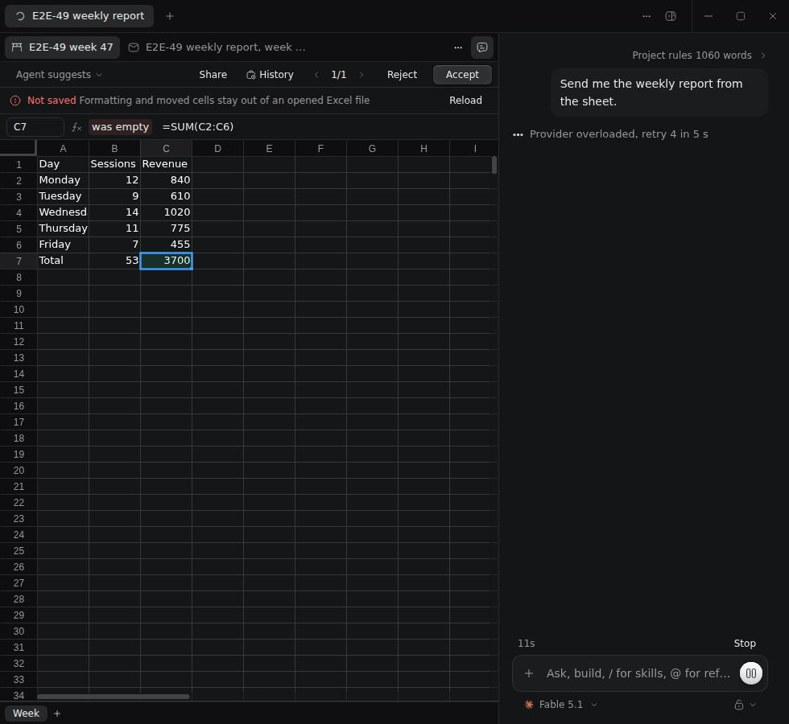
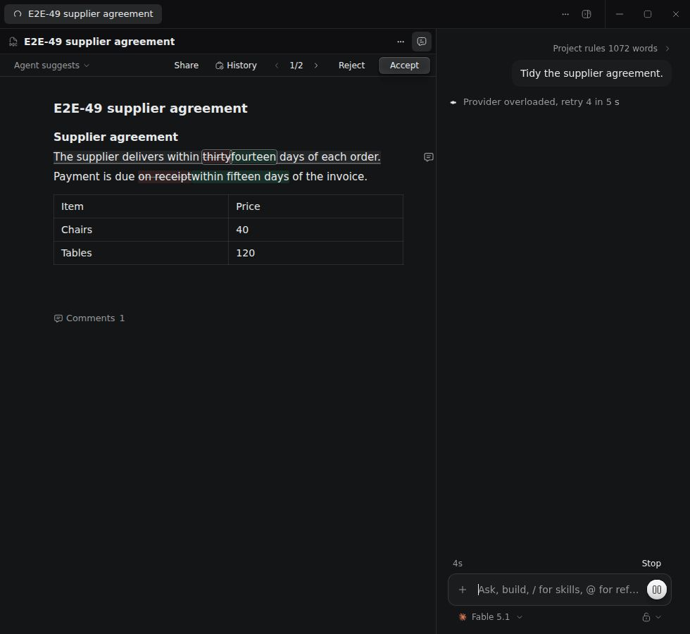
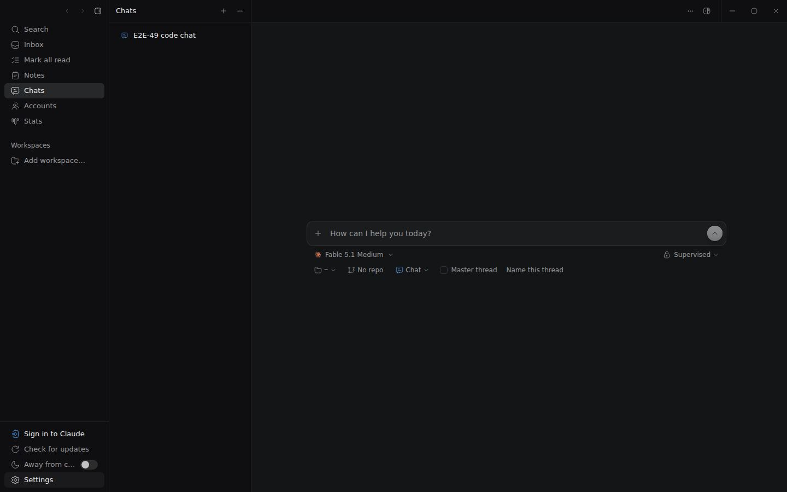
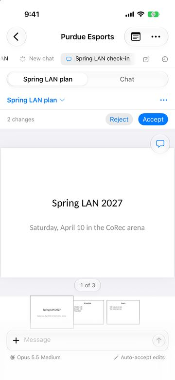

# Work: end-to-end proofs

Milestone 49 of the Work plan. Whole jobs, run on an isolated dev instance
of the built app against the owner's real LifeOS with dummy data; what each
proved, with pictures; and every line the build still has not proven, with
why and the steps that would prove it.

## Running them

Build once (`electron-vite build`), then from the repo root, one at a time:

```
env -u ELECTRON_RUN_AS_NODE bun scripts/e2e-work-triage.ts
env -u ELECTRON_RUN_AS_NODE bun scripts/e2e-work-report.ts
env -u ELECTRON_RUN_AS_NODE bun scripts/e2e-work-document.ts
env -u ELECTRON_RUN_AS_NODE bun scripts/e2e-work-meeting.ts
env -u ELECTRON_RUN_AS_NODE bun scripts/e2e-work-routine.ts
env -u ELECTRON_RUN_AS_NODE bun scripts/e2e-work-switchoff.ts
env -u ELECTRON_RUN_AS_NODE bun scripts/e2e-work-sweep.ts
```

Each prints PASS or FAIL per check, writes its pictures and a `run-*.txt`
to `.temp-code/plans/landed/M49/<job>/` (or `--out <dir>`), and exits
non-zero on any failure.

What they share is `scripts/e2e-work-lib.ts` (`Run`):

- One windowed instance under xvfb, in a folder of its own under /tmp,
  with its own HOME, userData, Work root, debug port and Work service port
  (both ports picked free). It never opens the installed app's database.
  It uses the box's installed conversion and meeting tools by linking each
  tool's folder into the run's own `work-tools/`; the run keeps its own
  `jobs/`, `run/` and `downloads/`, though a tool may still write its own
  cache in its folder (Python's `__pycache__`).
- LifeOS: the run mints a device session (`auth:mint`, named
  `E2E-49 <job> <time>`, never printed) and its sign-out revokes it; the
  run checks the sign-out. Deleting a Work workspace revokes its key; at
  the end the run revokes every key its instance minted that is still live,
  the Work Chats key (which reads every sector) among them, by the names in
  its own database.
- The agent's side is called as a thread's bridge calls it: `app.workCall`
  and `app.addonCall` with that thread's own tokens, from seeds the run
  sets (`TEMP_CODE_APP_TOKEN_SEED`, `TEMP_CODE_WORK_TOKEN_SEED`). No model
  turn runs: the instance's provider is a dead address. The owner's side is
  the wire (`work.outbox.send`, `work.meetings.decide`, …) or a press in
  the window.
- Every LifeOS record a job makes is named `E2E-49 …`. When the job ends,
  pass or fail, its own cleanups drop its tasks (with a reason; a dropped
  task stays in LifeOS's lists, marked dropped) and discard its drafts;
  then the run searches LifeOS for any task or draft named `E2E-49` still
  live, takes it away and fails. A cleanup that throws or answers an error
  fails the run too. `e2e-work-sweep.ts` revokes any `E2E-49` session or
  key still live and lists the TempCode keys made in the last day.
- Mail goes only to his own address. `E2E_SEND=1` lets the triage job send
  one mail to himself; every other run discards its drafts.
- A picture that could show his real lists (the rail, a workspace's
  column) is cut to the canvas and the thread (`shot(name, { clipLeft:
  460 })`). His address never reaches a check line or a picture: the run
  swaps it for "his own address" before each picture, and writes no picture
  that still shows it.

## Results

On the box (Linux, xvfb), 2026-11-19, on the branch's build over master with milestone 47 (`3aa164060`); every job ran twice in a row there, then once more with each change to its script.

| Job | What it proves | Runs |
|---|---|---|
| triage | morning triage to held drafts to the owner's batch | 2 of 2 (22 checks each) |
| report | a weekly report from a real .xlsx to a held mail | 2 of 2 (19) |
| document | a .docx through suggestions and a guest's edit to .docx, .odt, .md and PDF | 2 of 2 (17), and 2 of 2 on the Mac (17, guest leg left out) |
| meeting | a recording to accepted tasks in LifeOS | 2 of 2 (15) |
| routine | a routine that fires under Away and leaves a held item | 2 of 2 (17) |
| switchoff | Work off is the app before Work | 2 of 2 (17) |
| sweep | nothing a proof made is left in LifeOS | nothing live left; 20 proof tasks in LifeOS, all dropped |
| Windows hold | a Work thread's flagged submit on a Windows PC waits for his press | 2 of 2 in the rig |
| Mac | the document job under the Mac's Electron | 2 of 2 |
| Phone | the whole work set in the iOS simulator (45 shots), ios:test, ios:test:client | 2 of 2 |

### Morning triage to held drafts to a batch

A Work thread of his own mailbox's sector (Life) reads its key's guide
(Life only, draft-only), the inbox, files a task and drafts three replies
to his own address. The host stamps the thread's origin on each draft; all
three wait in the Outbox, grouped under the workspace with its "Send 3";
the thread's own `send_mail` is refused ("This key drafts and never
sends"). The owner sends the first through `work.outbox.send` with its
`rev` and discards the others: LifeOS records the sent one as `cause:
press`, to his address only, and every item is decided by the owner. The
first run sent that one mail; the second discarded all three.


### A weekly report from a sheet to a held mail

A real .xlsx (written by openpyxl, with a `=SUM` formula) opens in the
thread's canvas in the real Univer grid. `sheet_read` answers the week's
figures; the owner sets the sheet to suggest and the agent's revenue total
waits as a suggestion, the only one; the owner accepts it and the .xlsx on
disk holds `=SUM(C2:C6)` (read back by openpyxl). The agent drafts the
report from the rows it read; it waits in the Outbox with exactly those
figures, and the owner discards it.



### A document from a .docx

A Word file with a heading, paragraphs, a table and a reviewer's comment
(python-docx, author "Dana Lee") imports into a Work Chat's canvas as a
.tcdoc; the import answers `outsiders: true`. The agent reads the heading,
words, table and the comment. The owner sets it to suggest; the agent's
rewrite waits as one branch, tinted in the text, the text unchanged; Accept
all takes it. The document exports as .docx (python-docx reads back the
accepted words, the table and the comment), .odt and .md, and as a PDF
from Electron's own print window (`work.formats.print`, read back by
pdfium) — the print window's first run anywhere. The job hands the print
window the document's markdown as plain lines, not the editor's own page,
so the PDF shows `#` and table pipes: it proves the window, not the layout.

For the guest's edit the job runs milestone 31's live proof against this tree's built
hosted page: the real Work service and the guest page in headless
Chromium; a guest types into the owner's document and the owner's words
reach the guest; a view link writes nothing; a comment link marks words; a
revoked link ends the page. Why not live LifeOS: guest links share LifeOS
documents only, and a LifeOS document is served by the box's own Work
service, which runs only in the installed app on a Work build (below).




### A meeting file to accepted tasks

A 35-second recording of two people (the AMI corpus fixture) opens as a
meeting and is transcribed on the box: 4 turns, two speakers. The agent's
notes give two tasks resting on turns; both wait. The owner accepts one,
which the host files in his real LifeOS, in Life, with the description
"From “E2E-49 staff sync” at 0:00."; the rejected one is nowhere in LifeOS. The
filed task is dropped at the end with a reason.


### A routine that fires under Away

The owner turns Away on and saves a routine with a weekly rule for today,
two minutes ahead, in America/Chicago, ending after one run: the night's
firing brought forward. The host's engine fires it on its own clock and
starts a Work thread stamped with the run. That thread drafts the digest
through its own LifeOS key; the draft waits in the Outbox as the run's;
twenty seconds on, Away has released nothing; when the turn ends the run
says it holds one; the routine has ended. He turns Away off, sees the
digest waiting, and discards it.


### Work off is the app before Work

An instance that has never had Work on: the rail (Search, Inbox, Mark all
read, Notes, Chats, Accounts, Stats, workspaces), Settings' pages (Work is
listed, as the one switch), no Work service listening, a Work method
answering "Work is off on this host", a code thread given no Work tools.
Work is turned on (the service listens, the Outbox and Work Chats join the
rail, a Work workspace and a Work Chat are made) and off again: the rail
and Settings are as they were, the service has stopped, the method and the
code thread's tools answer as before (none, while on as well, when a Work
Chat gets its tools), and the database has gained no table (Work's tables
exist from the first boot). The Work workspace
is kept for when Work comes back.

The registry's own start paths are held by kept tests:
`work/switchOff.test.ts` (every way a code thread starts — a loose chat, a workspace chat, a project's
build with its rules, a child, one that opts out of the rules, Codex,
`app_start_thread`, `spawn_agent` — makes the same row and sends the same
first message with Work unset, off and on; it mounts no Work part, so it
holds what the registry itself does with the switch) and
`work/claude-driver.test.ts` (a code thread's Claude tool surface with no
Work, Work mounted and off, and Work on with a module's tools).




### Windows

`TC_WIN_RIG=1 NODE_ENV=test bunx vitest run src/main/server/computer/winRig.hold.test.ts`,
twice, on a fresh overlay of the rig: a Work thread's flagged click on
Edge's "Submit expense" became a live computer act in the real Outbox; under
Away the page stayed unsubmitted; his press submitted it once and a second
press posted nothing. The rig was stopped after.


The other Windows jobs do not apply: the rig has no Office, by the owner's
choice, so a workbook in real Excel on Windows is his PC's (below).

### The Mac

An Opus child on the Mac ran the document job twice from a scratch clone
(`/private/tmp`, its own userData and ports; the installed app untouched),
with `E2E_GUEST=0` and a scratch Python: 17 checks, all passed, both runs.
That is the .docx import with LibreOffice, the Work service's live editing
(Hocuspocus) under the Mac's Electron, suggestions and Accept all, the
exports, and the print window's PDF on macOS — the first time the service
and the print window ran on a Mac. The Mac had been idle 43 minutes and was
not locked. Excel 16.102.1 and Outlook 16.115 are installed; Word and
PowerPoint are not. Nothing was opened in Office (below).

### The phone

An Opus child on the Mac, on the branch over master with milestone 47:
`bun run ios:test` (51 tests) and `ios:test:client` (1,456 tests) passed;
the whole work set (`TC_PROOF_SET=work`: milestone 46's w01–w20 and 47's
w21–w45), simulator erased before each, passed twice (824 s and 712 s, all
45 shots). The host read back the same both times: the held mail sent from
the phone, what went was the phone's edit, a grant made from the post's
Send menu and the post going after it, Away on and off, both video comments
on the host at their frames (28 and 90).

It found a fault in the set: in a full run milestone 47's shots were taken
dark under "-light" names (milestone 46's part ends dark). It then made
three of milestone 47's four unproven lines run, in scripts only: the test
server can run the Work service in its own process
(`TC_TEST_WORK_SERVICE=1`), so the set now seeds a deck with two waiting
edits (LibreOffice 26.8.3 installed on the Mac with `brew install --cask
libreoffice`, python-pptx in a scratch venv named by `TC_PROOF_PPTX_VENV`),
a published form with three answers, and a history compare against a
second version. That run (milestone 47's part, light again) passed once.




## Faults the proofs found, and their fixes

- **Routines (milestone 32).** A run counted LifeOS's drafts by reading its
  threads' transcripts for a `draft_mail` call, so a draft made by any path
  the transcript does not name (a bridge call, as here) left the run
  "quiet: nothing held" while the Outbox showed it as the run's. A run now
  counts LifeOS's drafts from the Outbox's own list by the run their origin
  names, whenever the Outbox is watching LifeOS (a draft already sent or
  discarded no longer counts); the transcripts are read only otherwise.
  `routines/engine.ts` `heldBy`, two tests in `engine.test.ts`.
- **The Work service (milestone 18).** A token or an internal call made
  while the service was still starting was refused as "not running
  (starting)", so an agent's first document call after Work came on failed.
  Both now wait up to 20 s for a starting service. `service/ctx.ts`
  `runningSoon`, one test in `service/ctx.test.ts`.

Also from the phone leg, in the work set's scripts (milestones 46 and 47):
milestone 47's shots were dark in a full run; the slides seed passed
silently with LibreOffice present and never checked python-pptx. Both fixed
(above).

Seen and left as they are, for the pillar's owner to judge:

- A routine run's thread is titled by its prompt's first words ("Draft a
  short digest of…"), not the routine's name, and the Outbox's line names
  it so.
- The phone's history compare (w40) has no title saying which version it
  compares with the live document.
- With its provider at a dead address, a thread says "Provider overloaded,
  retry n in s" rather than that the provider cannot be reached.

## Still unproven

Each line: what, why it was not proven here, and what proves it. "Owner"
marks a step only he can take; the rest a later thread can run.

### Needs his accounts, his machines or his press

- **Real Office on the Mac** (milestones 28, 33, 21): Excel written
  through, its changes seen in the grid; Word and PowerPoint opening what
  we export; formatted Outlook mail. Why: Office scripting asks his one
  click per app on macOS's Automation prompt, needs the Apple Events
  entitlement in an installed build (F3; release 1.0.348 carries it), and
  no agent may answer that prompt for him. Word and PowerPoint are not
  installed on the Mac (Excel 16.102.1 and Outlook 16.115 are). Steps (owner, on the Mac, after
  installing a release with F3): from a Work thread whose workspace may use
  the Mac, with scratch files under /private/tmp only —
  1. Open Excel; make `/private/tmp/m28/xl-test.xlsx` with Sheet1 A1:C3
     values and C4 `=SUM(C1:C3)`. Ask the thread to call `office_files`;
     click Allow once on "TempCode wants to control Microsoft Excel".
  2. `office_range_read 'Sheet1'!A1:C4`, then `office_range_write
     'Sheet1'!A1` with the read hash: written. Type in A1 in Excel, write
     again with the old hash: `conflict`, nothing written.
     `office_range_undo` puts it back.
  3. Open the workbook in the sheet canvas; type in Excel and see the grid
     reload within 15 s; edit a cell in the grid and see it in Excel.
  4. Open Outlook, Allow once. `office_mail_send` to his own address from a
     non-Purdue account with bold, a link, a list and a 3×3 table: it is
     held; edit it in the Outbox, press Send, check the received copy.
  5. An invitation to himself from another account: `office_calendar_answer`
     accept is held; press; Outlook shows it accepted.
- **Every exported file in real Excel, Word and PowerPoint** (milestones
  21, 27, 33). Why: as above, and Word and PowerPoint are not on the Mac.
  Steps (owner, after installing Word and PowerPoint): open each file the proofs
  wrote — `.temp-code/plans/landed/M49/document/exports/` (.docx, .odt,
  .pdf), a sheet exported from the canvas (⋯ → Export → .xlsx), a deck from
  the slides canvas (.pptx) — in Word, Excel and PowerPoint; each opens with
  no repair prompt, the accepted words, the table and the reviewer's
  comment in the .docx, the formula's value in the .xlsx.
- **Office on Windows** (milestone 44). Why: the rig has no Office, by his
  choice. Steps: on a Windows PC with Office and TempCode installed, the
  checklist in landed/M44.md (COM reads and writes in Excel, Word,
  PowerPoint, classic Outlook; `Respond` on an invitation; a co-author's
  change; AppLocker refusing the helper in %TEMP%).
- **The Office add-in and Excel for the web** (milestone 29). Why: needs
  the tunnel rule (below) and his Microsoft sign-in. Steps (owner): the
  live test in landed/M29.md — sideload `addins/office/manifest.xml` in
  Excel for the web on a scratch OneDrive workbook, pair with the code from
  Settings → Work, `office_range_read`/`write` from a box Work thread, time
  a change by range, then Excel on the Mac through `wef/`.
- **Outlook on the web from the box** (milestone 38). Why: no agent may
  sign in as him. Steps (owner): landed/M38.md section 7 — export his
  Outlook cookies with `exportLogins.ts` (or sign in through the box
  browser over `chrome://inspect`), then `office_mail_list` on Sent, one
  formatted held send to himself, one calendar accept.
- **Google files** (milestone 30) and **Google calendar writes**
  (milestone 24). Why: needs his consent on his Google accounts, and two
  test Google accounts made with his phone. Steps (owner): landed/M30.md
  section 4 (consent on one personal account, the token route narrowing to
  `drive.file`, the client id, the Picker, a Doc and a Sheet round trip,
  then his Workspace account); landed/M24.md section 12 (make two test
  accounts; a thread finishes the live proof).
- **Frame.io** (milestone 48). Why: his Adobe sign-in, and the Settings
  rows are not mounted yet. Steps (owner): work-frameio.md, "The live
  test".
- **The tunnel's rule for the Work service** (milestones 18, 29, 31, 36).
  Guests, forms answered from outside, the phone's hosted editor and the
  Office add-in all go through `tempcode.landonhale.com/(g|w|f)/`, which is
  not applied. Steps (owner, on the Mac in the temp-code checkout with
  master pulled): `scripts/box/apply.sh --from 60 --through 60`; then on
  the box `cloudflared --config /etc/cloudflared/config.yml tunnel ingress
  rule https://tempcode.landonhale.com/w/doc/x` names
  `http://127.0.0.1:7695`.
- **LifeOS documents and sheets, live** (milestones 17, 19, 20, 27, 31).
  No LifeOS document or sheet exists yet: LifeOS's worker reaches the box's
  Work service at `/srv/agents/temp-code-data/work-service.sock`, which only
  the installed app on a Work build serves. Steps (owner): `box-update`,
  turn Work on for the box, turn LifeOS's `blockDocs` on; then in a Life
  Work thread `sheet_create` (a LifeOS sheet), Share → a guest link to
  himself opened in a private window, an edit there seen in TempCode.
- **Real model turns in Work threads** (milestones 6, 7, 14, 20, 23, 32,
  36, 39). No model has yet called a Work tool or a LifeOS tool in a real
  turn: every proof drove the thread's tools with its own tokens. Why: the
  Claude accounts are at their weekly cap, and copying the box's sign-in
  into a dev instance could rotate its refresh token. Steps (a later
  thread, when usage allows, or the owner once Work is on): in a Life Work
  thread, "Draft a mail to me with the subject Test and the body Hello":
  the draft is held in the Outbox with the thread's origin; a routine whose
  prompt drafts the same settles "Held 1".
- **Computer use on the Mac, live** (milestones 37, 10): portals, Teams
  posts and a held act on the Mac's own screen. Why: not run here, to keep
  to one Mac child at a time and the little usage left; the Mac was idle
  and unlocked during the Mac leg, so a child can run it.
  Steps: a Mac child after five idle minutes (the memory's idle gate) runs
  `bun scripts/e2e-computer.ts`; or the owner
  asks a Work thread on the Mac to fill a test form and presses its Send.
- **LifeOS desktop's approve-a-sign-in sheet** (milestones 2, 7, 8). Why:
  it ships with the next LifeOS desktop release; every proof signed in by a
  minted session. Steps (owner): after that release, Settings → Work → Sign
  in on a dev instance, approve the code in LifeOS desktop.
- **The hosted editor on the phone** (milestone 47): a LifeOS document
  edited in the web view and a suggestion accepted there. Why: the hosted
  editor serves LifeOS documents only, the simulator's test server has no
  LifeOS, and pressing Accept inside the web view needs a launch hook in the
  app. Steps: with the box's Work service live (above), open a LifeOS
  document from a phone thread's item row and accept a suggestion in its
  review; or a later milestone adds the hook and a scratch Convex behind
  the test server.
- **Accept pressed on a deck from the phone** (milestone 47): the deck and
  its review row are shown; the app has no launch hook to press Accept.
- **The phone on a real device** (milestones 45, 46, 47): lock-screen
  notices through APNs, the Duo's open postures, an iPad's windows. Steps
  (owner): install the Ad Hoc build, sign in, turn Away on, have a Work
  thread hold a mail, tap the notice.
- **The Purdue PC as a host** (milestones 41, 44). His choice; steps in
  the plan's open question 5.

### A later thread can prove

- **Two hosts live** (milestones 6, 8, 9, 14): a Work thread moved between
  two running instances, the switch written to both, Outbox items merged
  from two hosts. Proven on two databases and with fake hosts. Steps:
  `bun scripts/e2e-session-move.ts` with a Work thread added, or two
  `Run`s paired as `lifeos/proof/harness.ts` `pair` does.
- **The hourly LifeOS JWT refresh on a live connection** (milestone 7):
  a run held open past an hour.
- **The sheet worker as a utility process and IronCalc inside Electron**
  (milestones 15, 27): the report job's grid ran in the window; the worker's
  own fork was not watched. Steps: a structural save (insert a row) from
  the grid in `e2e-work-report.ts`, then read the instance log for the
  worker's start.
- **The meeting canvas's playback and a recording over 12 minutes**
  (milestone 35); a real Teams `.docx` or Zoom `.txt` export.
- **The PDF and slides canvases, media and forms in the running app**
  (milestones 33, 34, 36): seen in previews, headless Chrome and DOM tests.
  Steps: a job that opens a PDF, a deck and a video in a Work thread's
  canvas, as `e2e-work-report.ts` opens a workbook.
- **Muse and Codex Work threads in a real turn** (F1), **Muse on Windows**
  (milestones 13, 41).
- **ONLYOFFICE saving an Excel-written pivot** (milestone 40): needs a
  pivot made in real Excel.
- **A held row following its thread to another host** (milestone 10): it
  stays and goes stale.

Smaller unproven lines (a rotated page's crop, a classic-xref PDF's first
paint, a store app behind ApplicationFrameHost, a non-English Windows, the
`ax` tier's activation in the rig, and the like) are in each milestone's
landing note, "Not proven", and in each pillar's own doc.
